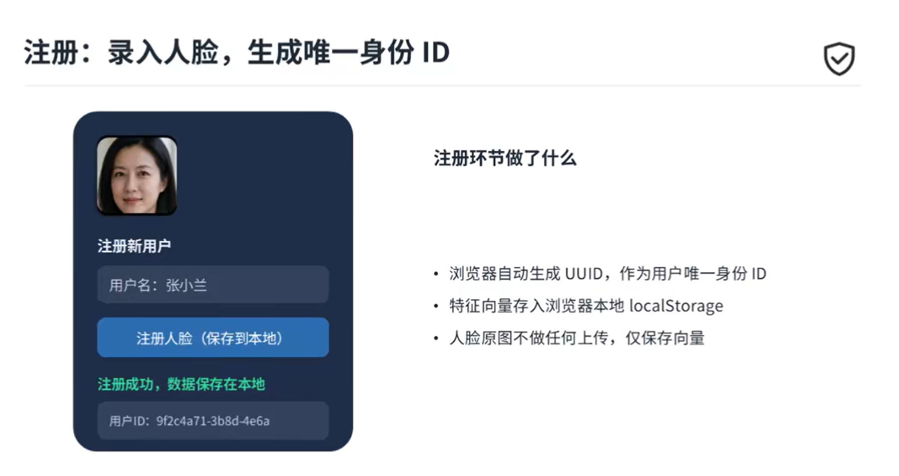

# 纯前端（H5）浏览器人脸识别系统

## 1. 方案概述
本系统采用 **“MediaPipe 人脸检测/关键点 + ONNX Runtime Web 推理引擎 + MobileFaceNet 特征提取”** 的纯前端架构。
核心逻辑：利用 MediaPipe 从摄像头/图片中精准定位人脸并输出关键点，通过**仿射变换（对齐）**将人脸裁剪为标准 112x112 图像，然后输入给由 ONNX Runtime 运行的 MobileFaceNet 模型，提取出 512 维特征向量。最终通过计算两组特征向量的**余弦相似度**来验证是否为同一人。
**优势**：无需服务器算力，图片数据不出端，隐私性极高，无云端服务费。
**劣势**：首次加载模型较慢（需下载 10MB+ 权重），极度依赖用户设备的摄像头素质及计算能力。

视频介绍： [https://v.douyin.com/GZwBZ35sW4w/](https://v.douyin.com/GZwBZ35sW4w/)

---

## 2. 技术原理与核心链路

### 2.1 MediaPipe 检测与对齐（核心难点）
不能直接把原始画面塞给识别模型，必须先“摆正”人脸。
1.  **关键点提取**：MediaPipe 返回 478 个 3D 关键点。我们取其中 5 个点：左眼中心(33)、右眼中心(263)、鼻尖(1)、左嘴角(61)、右嘴角(291)。
2.  **仿射变换（Affine Transform）**：MobileFaceNet 要求的输入是 **112×112 的 ArcFace 标准对齐图**。我们需要计算一个变换矩阵，将上述 5 个关键点映射到 ArcFace 预定义的标准坐标上。
3.  **裁剪**：利用 Canvas 的 `setTransform` 应用该矩阵，将原图裁剪并缩放至 112x112 画布上。**如果不做这一步，识别准确率将断崖式下降。**

### 2.2 特征向量的生成
对齐后的 112x112 图片，需要进行预处理并输入给 ONNX 模型。
*   **张量转换**：图片原本是 HWC（高宽通道）的 RGBA 格式，需转为模型需要的 NCHW（批次、通道、高、宽）格式：`[1, 3, 112, 112]`。
*   **归一化**：将 0-255 的像素值映射到 `[-1, 1]` 或 `[0, 1]`。MobileFaceNet 常用公式：`(pixel - 127.5) / 128.0`。
*   **推理**：喂给 ONNX 模型后，输出的一个长度为 **512**（或 128）的一维浮点数数组，这就是这张脸的“数学特征”。

### 2.3 特征向量的验证
*   **余弦相似度（Cosine Similarity）**：计算两个向量夹角的余弦值，范围 `[-1, 1]`。值越接近 1，说明两人长得越像。
*   **阈值判定**：行业常用阈值通常在 `0.4 ~ 0.6` 之间（本项目暂定 0.5）。大于阈值判定为同一人，小于则判定为不同人。

---

## 3. 细节注意事项（避坑指南）

1.  **ONNX 节点名必须匹配**：不同来源的 MobileFaceNet 模型，输入输出名称各不相同。必须通过 `console.log(ortSession.inputNames)` 打印确认（如常见的 `input.1` 和 `516`），并在代码中写死。
2.  **镜像问题**：
    *   **显示层**：前置摄像头画面和人脸预览框通常需要 CSS `transform: scaleX(-1)` 进行镜像，以符合照镜子的直觉。
    *   **计算层**：提取特征时必须基于**原始物理坐标**（即非镜像状态），否则得到的左右脸特征会与数据库中保存的相反，导致识别失败。
3.  **HTTPS 强制约束**：浏览器出于安全考虑，只有在 `HTTPS` 或 `localhost` 环境下才允许调用 `getUserMedia` 开启摄像头。
4.  **浮点运算的微小偏差**：同一个人同一张照片，哪怕连续推理两次，底层的浮点运算也会有极微小差异。因此**绝对不能对特征向量做 MD5/SHA 等哈希处理**，必须使用相似度算法。
5.  **无法防伪（活体检测）**：当前方案基于纯图像特征提取，**无法防范“拿一张照片对着摄像头”的作弊行为**。若用于正式生产环境，必须叠加眨眼、摇头等动作活体或静默活体模型。

---

## 4. 存储与“唯一编码”的设计

**不要把特征向量当作“身份证号”**。向量的本质是数学坐标，不能像 Hash 那样作为唯一标识符。真正落地的做法是：

1.  **系统唯一 ID**：系统在注册时，给用户分配一个 UUID 或用户 ID（如 `user_10086`）。
2.  **数据绑定**：将 `user_10086` 与 `特征向量数组` 绑定。
3.  **登录比对**：登录时，用户先输入账号（或依靠浏览器缓存的 Token 获取 ID），系统调出该 ID 绑定的向量，再与当前摄像头抓取的向量算相似度。
4.  **纯前端方案（设备级绑定）**：如果不接后端，可以将特征向量数组或生成的特征字符串存入浏览器的 `IndexedDB`。用户在该设备上打开页面，直接静默读取并比对。

---

## 5. 部署与扩展建议

*   **模型分离**：不要将 `.task` 和 `.onnx` 打包进前端代码，应放在 CDN 或静态服务器上，利用浏览器缓存机制（Service Worker）做离线化。
*   **降级策略**：如果用户设备性能太差，无法运行 WASM，可引导用户使用传统的密码登录。
*   **安全性增强**：如果要在纯前端保存特征，可以考虑结合 **WebCrypto API** 和用户设定的 PIN 码/密码对 `IndexedDB` 中的向量进行加密，进一步防止本地泄露。
*   
## 6. 版权声明
本项目为学习研究所用，项目中用到的第三方库保留原来的版权，请注意辨别。

## 7. 讨论联系
如有问题或建议，欢迎在项目仓库中提交 Issue 或 Pull Request，或通过以下方式联系我：

- 邮箱：[cancms@163.com](mailto:cancms@163.com)
- GitHub：[cancms2030](https://github.com/cancms2030) 